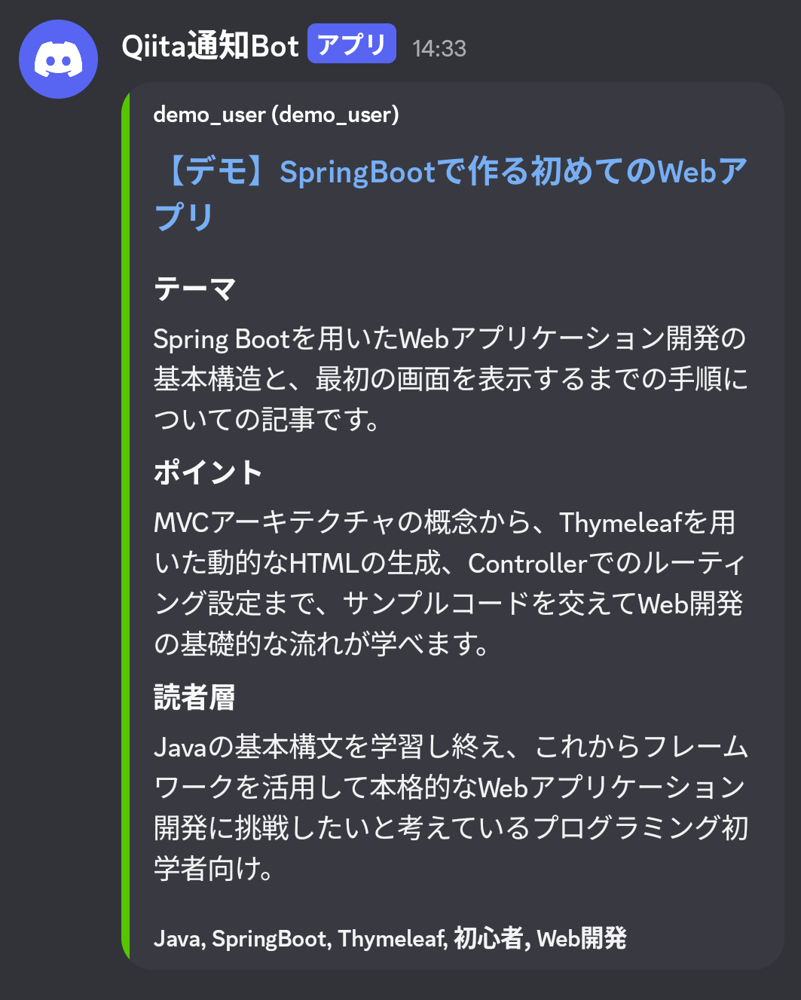

# あの話、もうQiita？

Qiitaの記事をタグで絞り込み、要約とともにDiscordへ通知するWebアプリです。

## デモ

[アプリを試す](https://mou-kiita.onrender.com/)

デモ画面で検索タグ・除外タグ・Discord Webhook URLを入力し、
通知ボタンを押すと、条件に合うQiita記事がDiscordへ送信されます。  

**▼ Discordへの通知イメージ**  

## 開発の背景・目的

**学習目的**  
職業訓練校や独学で学んだJavaやWebアプリケーション開発の知識を活用し、
学習成果を形にすることを目的として制作しました。  

**解決したい課題**  
IT関係の知識をキャッチアップするために技術ブログを読んでいて、自分から見に行かないと情報に触れにくい部分を感じていました。  
そこで、自動で最新記事を取得できたり、普段使っているDiscordに通知が行くと記事を読む機会が増えると思い、このwebアプリを作成しました。

## 機能一覧
- Qiita APIからタグに合う記事を取得
- 除外タグを指定して記事を絞り込み
- Gemini APIで記事のテーマ・ポイント・対象読者を要約
- 記事と要約をDiscordへ通知

## 使い方

1. 検索したいタグと除外したいタグを入力します。
2. 通知先となるDiscord Webhook URLを入力します。
3. 通知ボタンを押し、Discordで記事が届いたことを確認します。

## 使用技術

- Java 21
- Spring Boot 4.0.8
- Thymeleaf / HTML / CSS / JavaScript
- Qiita API / Gemini API / Discord Webhook API

## 利用上の注意・現在の制約

- 本アプリはポートフォリオ用のデモです。
- 通知は画面からボタンを押したときに実行されます。定期通知には対応していません。
- ユーザー登録や入力内容の保存は行いません。
- Webhook URLは通知処理のためにサーバーへ送信されます。信頼できる環境でのみ利用し、公開の場に貼り付けないでください。
- 外部APIの障害や利用制限などにより、通知できない場合があります。

## 今後の改善予定

現在は最小限の機能にとどまっていますが、将来的には「一度登録すると自動で通知されるシステム」への拡張を目標としています。

**利用者向け**
- ユーザーごとの設定保存機能(タグ・URLの保存、通知タイミングや回数の指定など)
- 定期実行による自動通知機能
- 記事情報のレイアウト調整

**システム内部**
- キャッシュ機能の追加による不要なAPI呼び出しの削減