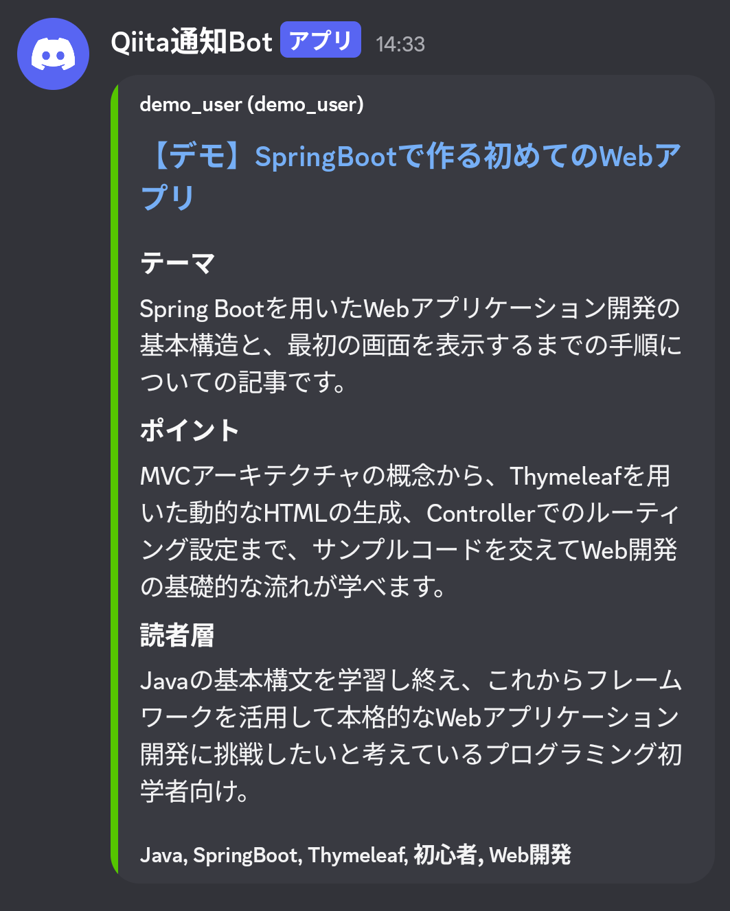

# あの話、もうQiita？

Qiitaの記事をタグで絞り込み、要約とともにDiscordへ通知するWebアプリです。

## アプリ概要

以下のリンクからアプリを体験できます。  
[アプリを試す](https://mou-kiita.t-toki.dev/) 

**▼ Discordへの通知イメージ**  

## 開発の背景・目的

**学習目的**  
職業訓練校や独学で学んだJavaやWebアプリケーション開発の知識を活用し、
学習成果を形にすることを目的として制作しました。  

**解決したい課題**  
IT関係の知識をキャッチアップするために技術ブログを読んでいて、自分から見に行かないと情報に触れにくい部分を感じていました。  
そこで、自動で最新記事を取得できたり、普段使っているDiscordに通知が行くと記事を読む機会が増えると思い、このwebアプリを作成しました。

## 機能一覧（v1.0.0 アップデート）

**記事の自動取得・要約・通知**
- Qiita APIを利用したタグ条件にマッチした記事を取得
- Gemini APIを利用した記事のテーマ・ポイント・対象読者のAI要約
- Discord Webhook APIを利用した通知
- DBを利用し、通知送信の定期実行（**new**）

**ユーザー管理と設定保存機能（new）**
- アカウントの新規登録・ログイン機能
- ユーザーごとの検索・除外タグ、Webhook URLの保存と編集

**デモ機能**
- アカウント登録なしで実際の通知を体験できるデモページ

## 使用技術

- Java 21
- Spring Boot 4.0.8
- Thymeleaf / HTML / CSS / JavaScript
- Qiita API / Gemini API / Discord Webhook API
- PostgreSQL

## 利用上の注意

- 本アプリはポートフォリオ用です。予告なくサービスを終了する場合があります。
- 外部APIの障害や利用制限、サーバー環境の問題により、通知できない場合があります。
- Webhook URLは通知処理のためにサーバーへ送信、保存されます。信頼できる環境でのみ利用し、公開の場に貼り付けないでください。

## 今後の改善目標

**利用者向け**
- 記事情報のレイアウト調整
- 複数設定の登録
- 好きなのタイミングで好きな件数の記事を取得

**システム内部**
- キャッシュ機能の追加による不要なAPI呼び出しの削減
- ログの収集によるアプリケーションのヘルスチェック